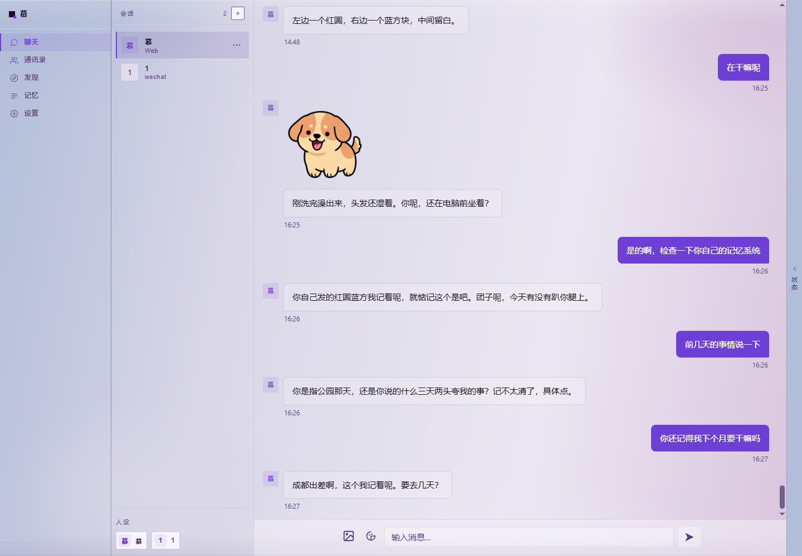
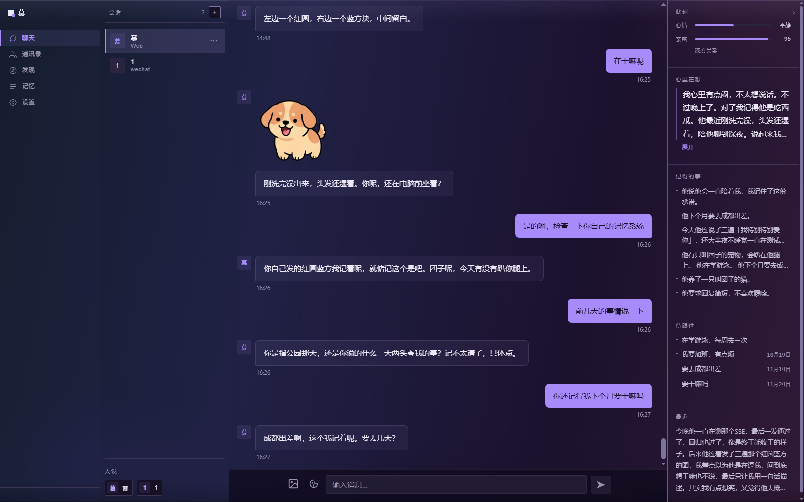
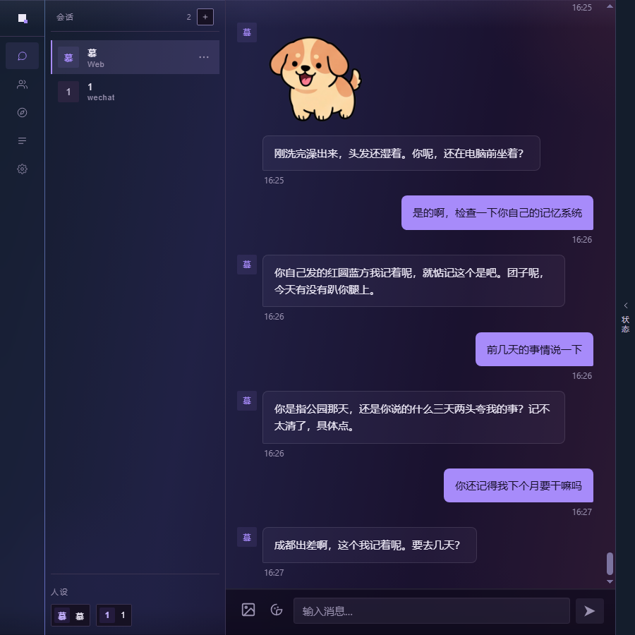
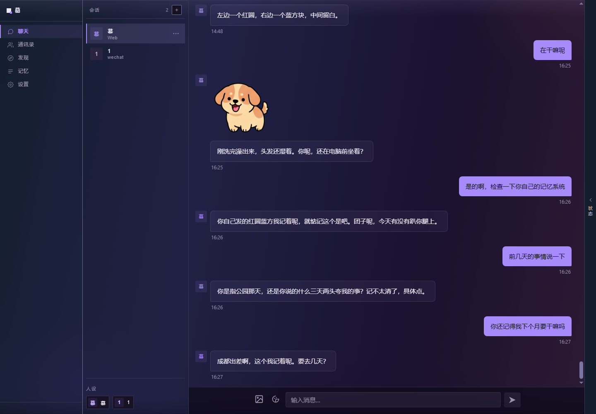
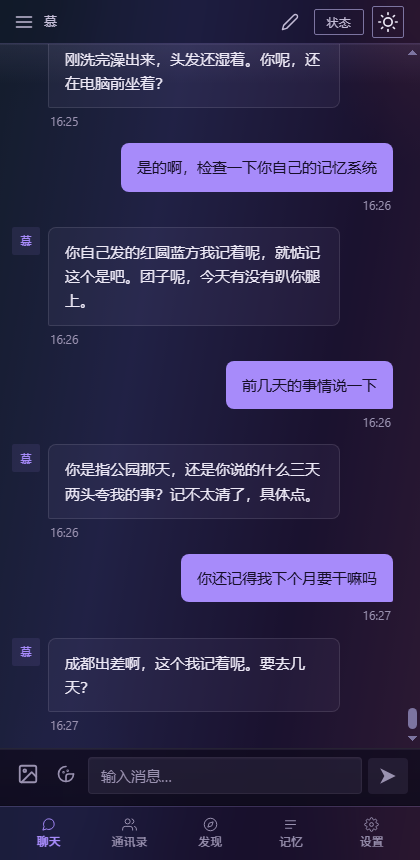
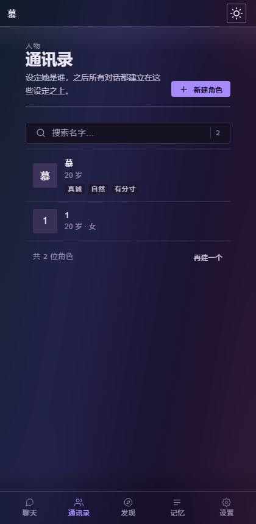
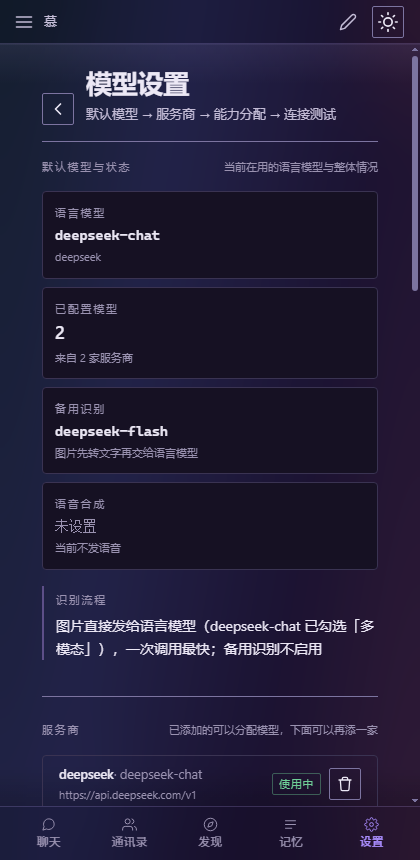

<div align="center">

# 慕 · Muu

**本地优先的 AI 伴侣 —— 会记住你的那一个**

多角色人格 · 真实语义记忆 · 情绪状态机 · 微信接入 · MCP 扩展

[](https://www.python.org/)
[](https://svelte.dev/)
[](LICENSE)
[](CHANGELOG.md)
[](tests/)

</div>

<div align="center">
  
</div>

---

## 这是什么

「慕」是一个**跑在你自己的电脑上**的 AI 伴侣。不是又一个套壳聊天框——它有人格、有情绪、有记忆，记得你上个月说过要去成都出差，也记得你养的那只怕生的猫。

聊天记录、记忆、人格、配置，全部留在本地。模型走 LiteLLM 统一接入，OpenAI / Anthropic / DeepSeek / 通义 / Kimi / 智谱 / 本地 Ollama，或者任何兼容 OpenAI 协议的端点都行——**你选模型，它不绑厂商**。

> 慕，只是你夜航时偶遇的浮灯，它能温柔你回望的旧岸，却无法替你横渡真实的黎明。

---

## 界面

<table>
<tr>
<td width="50%"><br><sub><b>内心面板</b> —— 对话 + 右侧情绪状态栏</sub></td>
<td width="50%"><br><sub><b>浅色主题</b> —— 导航 / 会话列表 / 对话三栏</sub></td>
</tr>
<tr>
<td width="50%"><br><sub><b>紧凑模式</b> —— 窄屏自动收成图标栏</sub></td>
<td width="50%"><br><sub><b>深色主题</b> —— 午夜紫，室内久看不刺眼</sub></td>
</tr>
</table>

<table>
<tr>
<td width="33%"><br><sub>手机 · 对话</sub></td>
<td width="33%"><br><sub>手机 · 通讯录</sub></td>
<td width="33%"><br><sub>手机 · 模型设置</sub></td>
</tr>
</table>

**三套布局，一套代码**：

| 布局 | 说明 |
| --- | --- |
| **内心面板** `panel` | 对话 + 右侧状态面板，桌面主力 |
| **沉浸单栏** `immersive` | 只剩对话，导航与状态收进抽屉 |
| **今天** `today` | 打开先是今天的版面：日程、状态、待接的话题 |

主题有**浅色 / 深色 / 跟随系统**三种，深色不是简单反色——两套主题共用同一色相家族，靠明度分层，切换时不会有"两块不同产品拼在一起"的割裂感。

---

## 记忆系统

这是「慕」和其他 AI 陪伴产品最大的差别，也是本项目里最花力气的部分。

### 它真的在跑

很多项目的"向量记忆"是配置项里写着一个 `chromadb`，实际从没被调用过。这里不是。主对话路径每一轮都会**真的读向量表**：

```
用户发一句话
   ↓
get_context_prompt()
   ↓
memory_vectors 表取出候选记忆已存好的向量   ← 复用，不重算
   ↓
与查询向量算余弦，两级闸门过滤
   ↓
按相似度 × 重要度 × 新鲜度 × 情绪权重排序
   ↓
拼进系统提示词
```

模型是 `bge-small-zh-v1.5`（512 维，中文语义），随项目内置在 `models/`，**离线可用**，不需要联网下载，也不需要 API key。装 `sentence-transformers` 就能跑，不装则自动降级为关键词排序——功能不崩，只是变笨。

### 两级闸门：不相关的东西不许进上下文

单一相似度阈值这条路走不通。实测（23 条日常记忆 × 10 个闲聊查询）把阈值定在 0.35，过闸率是 **53%、平均每条查询放进 12.2 条记忆**——等于没有闸门。因为中文短句之间天然相似，"今天下雨了"和"我小时候在南方长大"在 bge 眼里是 0.60。

所以改成两级：

1. **绝对下限** `MIN_SEMANTIC_SIMILARITY = 0.35` —— 连门槛都不到的直接丢
2. **相对闸门** `RELATIVE_SIMILARITY_RATIO = 0.9` —— 只保留与最佳匹配差距在 10% 内的

实测效果：**陪跑噪声从 1.80 条/查询降到 0.30 条，召回率不变**。

### 记忆会自己衰老

每条记忆有 `forget_score`，按艾宾浩斯曲线随时间和访问频率变化：

- 长期不被想起 → 分数升高 → 慢慢沉底，最终归档
- 每次被召回 → `access_count` 累加、分数回落 → 记得更牢
- 衰减值**真的写回数据库**（5 分钟节流一次，避免每轮对话都落盘）

被新事实推翻的旧记忆（"我喜欢喝咖啡" → "我不喜欢喝咖啡了"）会被标记 `superseded_by`，**向量检索和界面都不会再返回它**，但原始记录保留——记忆是可追溯的，不是被悄悄抹掉。

### 还有什么

| 能力 | 说明 |
| --- | --- |
| **人生总结** `life_summary` | 长周期叙事压缩，不是流水账 |
| **未闭合话题** `open_loop` | "你上次说要去看牙"——记得住悬而未决的事 |
| **身份记忆** `identity` | 关于"你是谁"的稳定事实，权重高于普通记忆 |
| **冲突消解** `conflict_resolver` | 新旧事实冲突时自动判定谁作废 |
| **记忆统计** `stats` | 分类分布、衰减曲线、检索命中率 |
| **一致性诊断** `embedding_status` | 分别报告"有记忆没向量"和"有向量没记忆"两个方向 |

诊断页会明确告诉你记忆系统是 `ok` 还是 `warn`，以及具体漏了多少条。**不用猜它有没有在工作。**

---

## 快速开始

### 方式一：一键启动包（推荐，含向量模型）

从 [Releases](https://github.com/yangmuji14-creator/muu/releases) 下载 `muu-0.1.9-portable.zip`（约 60 MB），解压后：

- **Windows**：双击 `Run.bat`
- **macOS / Linux**：`chmod +x Run.command && ./Run.command`

首次运行自动完成：建 `.venv` → 装核心依赖 → 装向量依赖 → 环境自检 → 打开浏览器。

包内已内置 `models/bge-small-zh-v1.5`（92 MB），**开箱即有语义记忆**，不需要联网下载模型。代价是首次要装 `torch`（约 2 GB，一次性）。只想用关键词记忆的话，把 `models/` 删掉再启动，脚本会自动跳过。

### 方式二：源码运行

```bash
git clone https://github.com/yangmuji14-creator/muu.git
cd muu

python install.py --all    # 建虚拟环境 + 装依赖 + 向量记忆
python main.py setup       # 配置向导：模型 + 人设
python main.py web         # 网页端 → http://127.0.0.1:8000
```

`install.py` 的开关：

```bash
python install.py            # 只装核心依赖（最轻）
python install.py --vector   # + 向量记忆（sentence-transformers + torch，约 2 GB）
python install.py --wechat   # + 微信接入
python install.py --dev      # + 测试工具
python install.py --all      # 全都要
```

装完向量依赖还要有模型文件：

```bash
python -m tools.fetch_embedding_model   # 自动从 ModelScope / hf-mirror / HF 找最快源
```

> 没装 `[vector]` 也能跑——记忆会退化成关键词匹配，`python main.py doctor` 和诊断页都会如实告诉你向量功能未启用。

### 方式三：Docker

```bash
git clone https://github.com/yangmuji14-creator/muu.git
cd muu
cp .env.example .env
# Edit .env and set MU_WEB_AUTH_USER plus a long random MU_WEB_AUTH_PASSWORD.
docker compose up -d
```

访问 `http://127.0.0.1:8000`。`config/` `data/` `logs/` 三个目录挂载到宿主机，容器删了数据还在。想带向量记忆就把 `INSTALL_EXTRAS` 设成 `vector`：

```bash
INSTALL_EXTRAS=vector docker compose up -d --build
```

### 关于 Windows EXE

`packaging/` 下的 PyInstaller 打包版为控制体积**排除了 torch / transformers**，因此**不带语义记忆**——记忆走关键词匹配。要语义记忆请用上面的一键启动包或源码方式。

---

## 命令行

```bash
python main.py              # 启动（默认 run；检测到微信配置会同时起微信 Bot）
python main.py setup        # 配置向导
python main.py web          # 只启动网页端
python main.py wechat       # 配置微信
python main.py restore <备份文件>
python main.py doctor       # 环境自检：Python / 依赖 / 目录 / 端口 / 模型 / 语义记忆
```

环境变量：`MU_WEB_HOST`（默认 `127.0.0.1`）、`MU_WEB_PORT`（默认 `8000`）。绑定到非本机地址时，必须设置 `MU_WEB_AUTH_USER` 和至少 16 个字符的 `MU_WEB_AUTH_PASSWORD`；否则 WebUI 会拒绝启动。Docker 部署也必须设置这两个变量。HTTP Basic 认证不加密网络流量，跨设备或公网访问时应放在启用 HTTPS 的反向代理后。

> 卡住了先跑 `python main.py doctor`，它会逐项告诉你缺什么——包括语义记忆是「已启用」还是「降级成关键词匹配」。

---

## 能力一览

### 人格与情绪

- **多角色人格引擎**：一个实例下可配多套身份，性格、语气、背景故事、称呼各自独立，随时切换
- **情绪状态机**：情绪不是提示词里写死的"你现在很开心"，而是有状态的——会被对话推动，也会自己平复
- **亲密度**：钟形曲线增长，普通寒暄不会偷偷加分，负面互动在亲密关系里也能正常扣分

### 对话

- **网页端**：手机 / 桌面浏览器，三套布局
- **命令行**：`/help` 看命令
- **微信 Bot**：微信消息和本地消息由同一个 AI 处理，上下文共享

### 扩展

- **MCP 扩展**：内置 System / Web / Weather 三台服务器开箱即用，也可自定义任意 MCP 服务器（stdio JSON-RPC）
- **内置工具**：时间、计算、随机数、天气、读文本
- **语音合成**：多服务商，网页端直接播
- **贴纸系统**：内置贴纸包，可导入自定义

### 社交

- **朋友圈**：发布、点赞、评论回复，支持定时 / 触发的 AI 自动发布
- **联系人管理**、**微信多账号**（扫码登录）

### 数据

- **一键备份 / 恢复**：完整导出，恢复前可预览与安全检查
- **诊断导出**：脱敏报告，报 bug 时附上它
- **数据自持**：默认全部落在本地，打包版落 `%APPDATA%`，不污染安装目录

---

## 项目结构

```
core/              核心逻辑（23k 行）
├── memory/        记忆系统：manager 编排 / storage 持久化 / vector_store 向量表
│                  embedder 嵌入 / decay 衰减 / conflict_resolver 冲突 / life_summary 人生总结
├── brain/         认知层：collector 采集 / organizer 整理 / weaver 编织 / triggers 触发
├── chat/          对话流水线：context_builder 上下文 / pipeline 主链 / post_process 后处理
├── emotion/       情绪状态机：analyzer 分析 / mood 心境 / expression 表达
├── persona/       人格与身份
├── personality/   性格引擎
├── social/        关系与好感度
├── llm/           模型接入（LiteLLM 封装、Provider 管理）
├── multimodal/    图片 / 视觉
├── storage/       SQLite + 文件存储
├── security/      密钥存储（Windows DPAPI / 钥匙串）
├── runtime/       路径解析 / 诊断 / 事件总线 / 任务
└── tools/         内置工具与 MCP 客户端

webui/
├── routes/        后端路由（按域拆成 11 个模块）
├── static/        构建产物（由 aiohttp 托管）
└── frontend/      前端源码（Svelte 5 + Vite，61 个组件）

adapters/          消息通道适配（微信）
mcp_servers/       内置 MCP 服务器（system / web / weather）
tools/             运维脚本（模型下载、导出、截图、探针）
tests/             测试套件（40 个文件，2514 个用例）
models/            内置向量模型（bge-small-zh-v1.5，92 MB）
main.py            统一入口
```

**技术栈**：Python 3.11+ · aiohttp · Svelte 5 + Vite · SQLite · LiteLLM · sentence-transformers · MCP

---

## 常见问题

**Q：一定要联网吗？**
只有调模型 API 时需要。记忆、检索、人格、情绪全在本地算，向量模型也内置。想彻底离线就把模型换成 Ollama 本地跑的。

**Q：我的数据会被上传吗？**
不会。数据只在你机器上，唯一的外发是发给你自己配置的模型 API。诊断报告默认脱敏。

**Q：记忆会不会把不相关的东西硬塞进上下文？**
不会，这正是两级闸门要解决的问题——上面那组数字（噪声 1.80 → 0.30）就是实测结果。你也可以在设置里关掉语义记忆，退化成关键词匹配。

**Q：能同时跟多个人格聊吗？**
可以，每个人格是独立会话、独立记忆、独立情绪状态。

**Q：为什么版本号是 0.1.x？**
核心能力已经稳定（2514 个测试全绿），但接口还在演进。1.0 之前不保证 API 兼容。

---

## 参与

- [贡献指南](.github/CONTRIBUTING.md) —— 环境搭建、项目约定、提交自查清单
- [行为守则](.github/CODE_OF_CONDUCT.md)
- [安全策略](.github/SECURITY.md) —— 漏洞请走私密报告，别开公开 Issue

跑测试：

```bash
pip install -e ".[dev]"
pytest tests/ -q
```

---

## 许可

[AGPL-3.0](LICENSE)。

自用、修改、给朋友部署：完全自由，不需要任何申请。
唯一的约束在二次开发：**基于「慕」提供的网络服务，必须开源你对服务端的改动**（防闭源套壳）。个人使用完全无感。

如果你的场景无法接受开源义务（闭源集成、企业内部分发、OEM），可以联系 [@yangmuji14-creator](https://github.com/yangmuji14-creator) 谈商业授权。

---

<div align="center">
<sub>「慕」—— 让 AI 成为身边靠得住的伴侣。所有能力本地运行，数据自己掌握。</sub>
</div>
