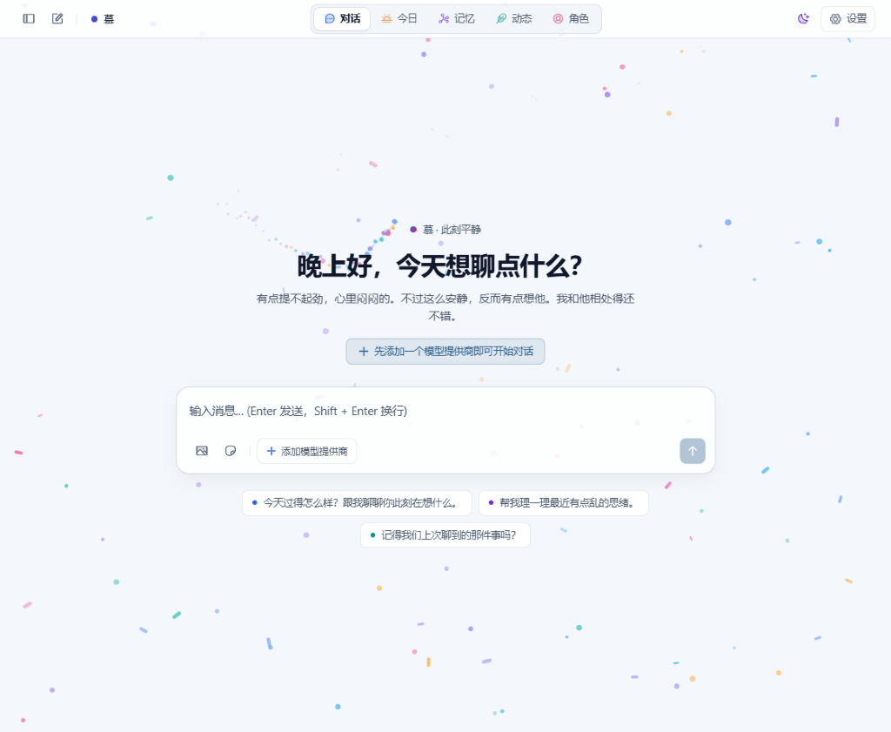
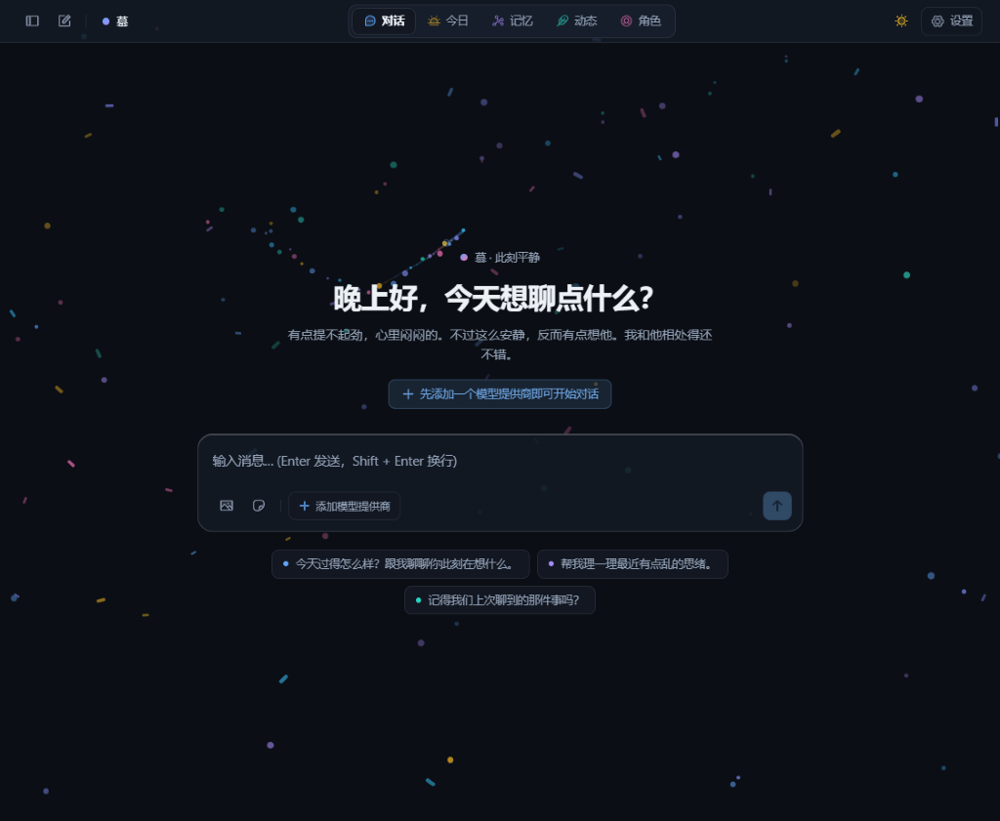
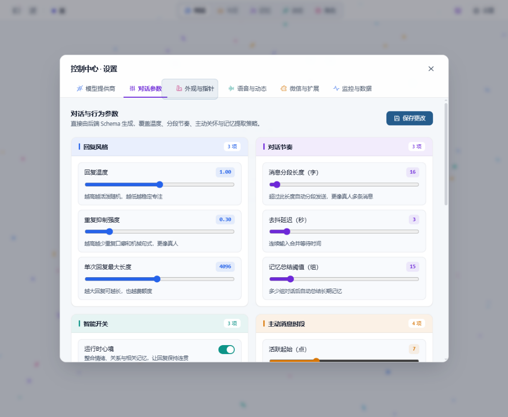
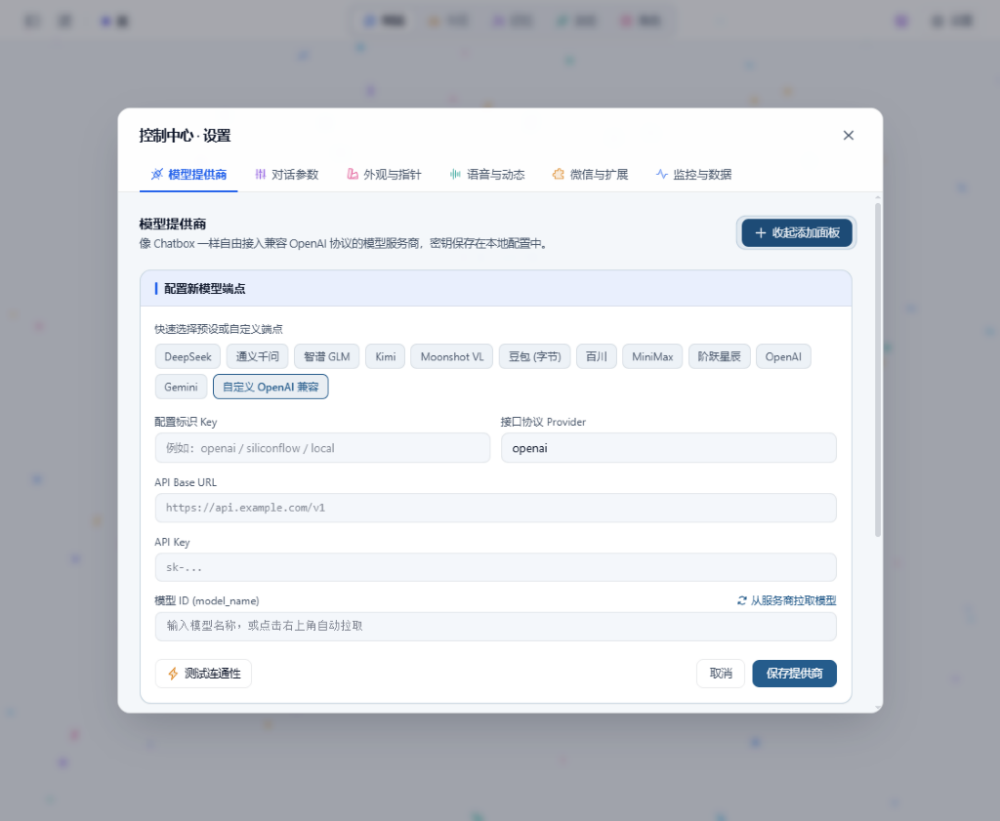
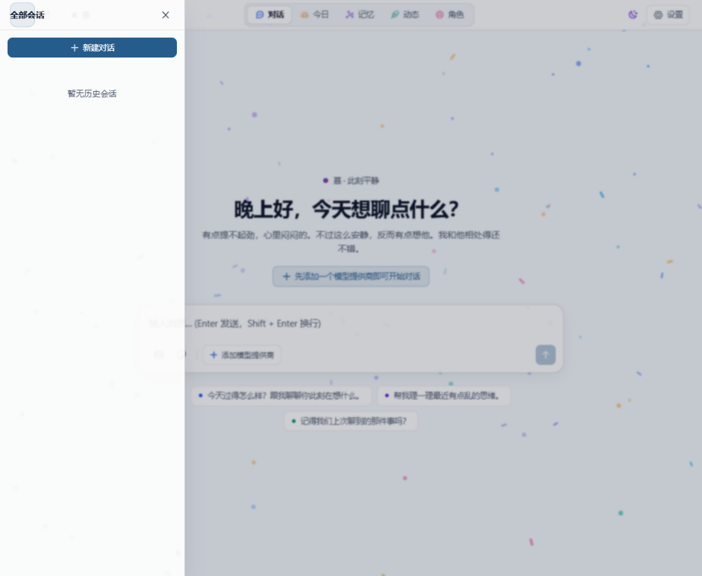
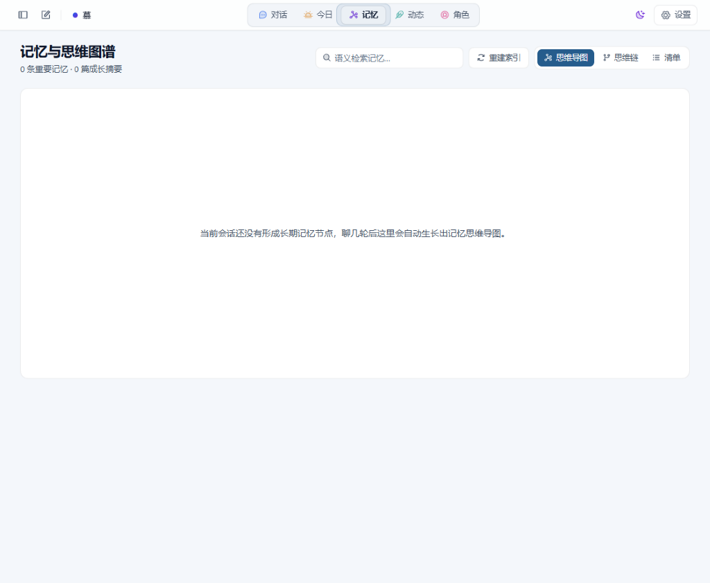

<div align="center">

# 慕 · Muu

**本地优先的 AI 伴侣 —— 会记住你的那一个**

多角色人格 · 因果语义记忆 · 情绪状态机 · React 19 桌面界面 · 微信接入 · MCP 扩展

[](https://www.python.org/)
[](https://react.dev/)
[](https://www.typescriptlang.org/)
[](https://tailwindcss.com/)
[](LICENSE)
[](CHANGELOG.md)
[](tests/)

[快速开始](#-快速开始) · [界面预览](#-界面预览) · [记忆系统](#-记忆系统) · [功能矩阵](#-能力一览) · [更新日志](CHANGELOG.md)

</div>

<div align="center">
  
</div>

---

## 这是什么

「慕」是一个**完全运行在你自己设备上的本地优先 AI 伴侣**。它不是又一个套壳聊天框——它拥有独立的多角色人格、连续演化的情绪状态机与真正参与每轮推理的长期记忆系统：记得你上个月提过的安排，也记得你的喜好与近况变化。

对话历史、语义向量库、人格设定与 API 密钥全部保存在本地（Windows DPAPI / 系统钥匙串加密保护）。模型层通过 LiteLLM 统一接入，OpenAI、Claude、Gemini、DeepSeek、通义千问、Kimi、智谱、Ollama 或任意兼容 OpenAI 协议的端点都可自由切换——**模型任你选，数据只归你**。

> 慕，只是你夜航时偶遇的浮灯，它能温柔你回望的旧岸，却无法替你横渡真实的黎明。

---

## 界面预览

全新重构的 **React 19 + TypeScript + Tailwind CSS v4** 桌面界面，采用「浅色冷霜 / 深色冷曜」双主题与低饱和语义彩阶，配合贴边直通抽屉、居中控制中心、Phosphor 双色图标及多彩失重微粒动效：

<table>
  <tr>
    <td width="50%">
      
      <br><sub><b>浅色 · 冷霜主题</b> — 多彩失重微粒与指针拖尾、极简顶栏与悬浮输入栏</sub>
    </td>
    <td width="50%">
      
      <br><sub><b>深色 · 冷曜主题</b> — 低眩光石墨深底，夜间长聊依然通透舒适</sub>
    </td>
  </tr>
  <tr>
    <td width="50%">
      
      <br><sub><b>控制中心 · 对话参数</b> — 彩色下划线 Tab 与三层着色分隔面板</sub>
    </td>
    <td width="50%">
      
      <br><sub><b>模型提供商管理</b> — 多端点接入、连通性测试与一键拉取可用模型</sub>
    </td>
  </tr>
  <tr>
    <td width="50%">
      
      <br><sub><b>贴边直通抽屉</b> — 48px 顶栏对齐，支持重命名与跨角色会话管理</sub>
    </td>
    <td width="50%">
      
      <br><sub><b>记忆与思维图谱</b> — 思维导图、时间轴思维链与语义检索三视图</sub>
    </td>
  </tr>
</table>

<details>
<summary>界面与交互设计亮点</summary>

- **流式思考可视化**：完整兼容 SSE `reasoning` 事件与内联 `<think>` 标签，支持思考耗时统计与折叠回看。
- **自适应磁吸指针**：纯零 DOM 篡改悬停框，针对导航与 Tab 留出宽松呼吸边距，进入输入区域自动退回原生文本光标。
- **伴侣实时心境抽屉**：左上角极简状态入口一键拉出右侧心情、精力、关系阶段、未闭合话题与最近日记。
- **无障碍高对比度保障**：全站 38 组表面配色配对通过 `tools/check_contrast.py` 与 136 项设计 token 自动化校验。

</details>

---

## 记忆系统

这是「慕」最核心的工程投入。主对话流水线每一轮都会真实查询本地向量库与记忆状态，而不是把旧记录机械拼接进 Prompt：

```text
用户发送消息
   │
   ├─► get_context_prompt()
   │     ├── 从 SQLite memory_vectors 复用已存 512 维向量（bge-small-zh-v1.5，本地离线运行）
   │     ├── 动态记忆闸门（dynamic_gate）：结合绝对下限与相对比例过滤闲聊噪声
   │     ├── 遗忘曲线与访问频次加权排序（forget_score 节流落盘，越常回忆越牢固）
   │     └── 拼接近期日记摘要 + 未闭合事项（open_loop）注入系统提示词
   │
   └─► 后处理认知编排
         ├── 记忆提炼与矛盾消解（conflict_resolver）：新事实自动作废旧事实并保留溯源
         ├── 因果链识别（causal_linker）：串联跨轮事件的因果关系
         └── 生命周期管理（lifecycle_manager）：自动归档沉底条目并同步清理孤儿向量
```

- **离线可用**：内置 `models/bge-small-zh-v1.5/`（92 MB）无需联网即可语义检索；未安装向量依赖时自动降级为关键词召回。
- **诊断透明**：`python main.py doctor` 与网页端「监控与数据」可实时自检「有记忆缺向量 / 有向量无记忆」状态并一键重建索引。

---

## 快速开始

### 方式一：Windows 离线开箱即用包（推荐，免装环境）

从 [GitHub Releases](https://github.com/yangmuji14-creator/muu/releases) 下载最新版 **`muu-0.3.0-win64-portable.zip`**，完整解压后直接双击运行：

- **Windows**：双击 `Run.bat`

压缩包已内置嵌入式 Python 3.12、全部核心/微信依赖、CPU 版 PyTorch 与本地中文向量模型 `models/bge-small-zh-v1.5`（91.9 MB）——**无需在本机安装 Python，也无需联网下载任何依赖包**，首次启动自动初始化配置并打开 `http://127.0.0.1:8000`。

macOS / Linux 用户请按下方「方式二：源码运行」（仓库内 `Run.command` / `start.sh` 也支持在有 `python3` 时一键建虚拟环境拉起）。

### 方式二：源码运行

```bash
git clone https://github.com/yangmuji14-creator/muu.git
cd muu

python install.py --all     # 创建虚拟环境并安装全量依赖（也可按需 --vector / --wechat / --dev）
python main.py setup        # 交互式向导：配置模型与角色
python main.py web          # 启动 WebUI → http://127.0.0.1:8000
```

如需拉取本地向量模型：

```bash
python -m tools.fetch_embedding_model
```

前端开发与生产构建（修改 `webui/frontend/` 后执行）：

```bash
cd webui/frontend
npm install
npm run build               # 产物自动输出至 webui/static/
```

### 方式三：Docker 部署

```bash
git clone https://github.com/yangmuji14-creator/muu.git
cd muu
cp .env.example .env
# 在 .env 中设置 MU_WEB_AUTH_USER 与至少 16 位的 MU_WEB_AUTH_PASSWORD
docker compose up -d
```

如需启用语义向量记忆，可将 `INSTALL_EXTRAS=vector` 写入构建参数：

```bash
INSTALL_EXTRAS=vector docker compose up -d --build
```

---

## 命令行工具

```bash
python main.py              # 启动主程序（检测到微信配置时同步拉起微信端）
python main.py setup        # 命令行初始化配置向导
python main.py web          # 仅启动 Web 控制台（默认 127.0.0.1:8000）
python main.py wechat       # 微信账号配置与扫码管理
python main.py restore <备份.zip>  # 从加密安全校验的备份包恢复
python main.py doctor       # 全量环境自检：Python / 依赖 / 端口 / 向量模型状态
```

> [!IMPORTANT]
> **公网与跨设备安全约束**：当 `MU_WEB_HOST` 绑定到非本机回环地址时，必须设置 `MU_WEB_AUTH_USER` 与至少 16 个字符的 `MU_WEB_AUTH_PASSWORD`，否则 WebUI 将拒绝启动；公网暴露请配合 HTTPS 反向代理使用。

---

## 能力一览

| 模块 | 核心能力 |
| --- | --- |
| **人格与情感** | 多角色独立档案与人格漂移引擎 · 多维情绪状态机 · 基于互动质量的好感度成长曲线 |
| **记忆与认知** | `bge-small-zh-v1.5` 向量语义检索 · 动态闸门 · 因果链识别 · 矛盾消解 · 艾宾浩斯遗忘衰减 · 阶段日记 |
| **多端对话** | React 19 流式对话 WebUI（支持推理折叠与图文表情）· CLI 交互 · 微信多账号共享上下文接入 |
| **工具与扩展** | 内置 System / Web / Weather 三个 MCP 服务器 · 自定义 stdio MCP · TTS 语音合成 · 贴纸系统 |
| **社交与主动关怀** | 动态广场（发布 / 点赞 / 评论 / 自动发动态）· 定时与事件触发的主动消息 · 未闭合话题追问 |
| **本地安全运维** | DPAPI / 系统钥匙串密钥加密 · 完整数据备份恢复 · 一键导出脱敏诊断包 |

---

## 项目结构

```text
core/                 核心业务与认知引擎
├── brain/            后台认知编排（采集 / 整理 / 编织 / 触发器）
├── chat/             对话主流水线（上下文构建 / 流式生成 / 后处理）
├── emotion/          情绪分析、心境状态机与表达约束
├── llm/              LiteLLM 统一适配、厂商目录与连通性诊断
├── memory/           向量库、动态闸门、因果链、衰减、冲突消解与生命周期
├── persona/          角色加载、人格漂移与提示词装配
├── security/         Windows DPAPI 与跨平台密钥加密存储
├── social/           关系阶段与好感度持久化
└── tools/            内置工具与 MCP 客户端

webui/
├── routes/           后端 API 路由与状态存储模块（18 个模块）
├── frontend/         React 19 + TypeScript + Vite 6 + Tailwind v4 前端源码（37 个源文件）
└── static/           生产构建产物（由 aiohttp 托管）

adapters/             消息通道适配（微信 iLink）
mcp_servers/          内置 MCP 服务器（system / web / weather）
tools/                运维、打包与视觉对比度校验脚本
tests/                自动化测试套件（2,745 passed）
```

---

## 测试与质量保障

```bash
pip install -e ".[dev]"
pytest tests/ -q
python tools/check_contrast.py
```

---

## 参与贡献

欢迎阅读社区协作文档：

- [贡献指南](.github/CONTRIBUTING.md)
- [行为守则](.github/CODE_OF_CONDUCT.md)
- [安全策略](.github/SECURITY.md)（安全漏洞请通过 GitHub Security Advisories 私密提交）

---

## 许可

本项目采用 [AGPL-3.0](LICENSE) 开源许可。

- 个人学习、修改与自部署完全自由，无需额外申请。
- 若基于本项目向第三方提供网络服务，需按 AGPL-3.0 开源你对服务端的修改。
- 如需闭源集成、企业内部专有分发或商业授权，请联系项目作者 [@yangmuji14-creator](https://github.com/yangmuji14-creator)。

<div align="center">
  <sub>Created by <a href="https://github.com/yangmuji14-creator">yangmuji14-creator</a> · 本地运行，记忆常在</sub>
</div>
