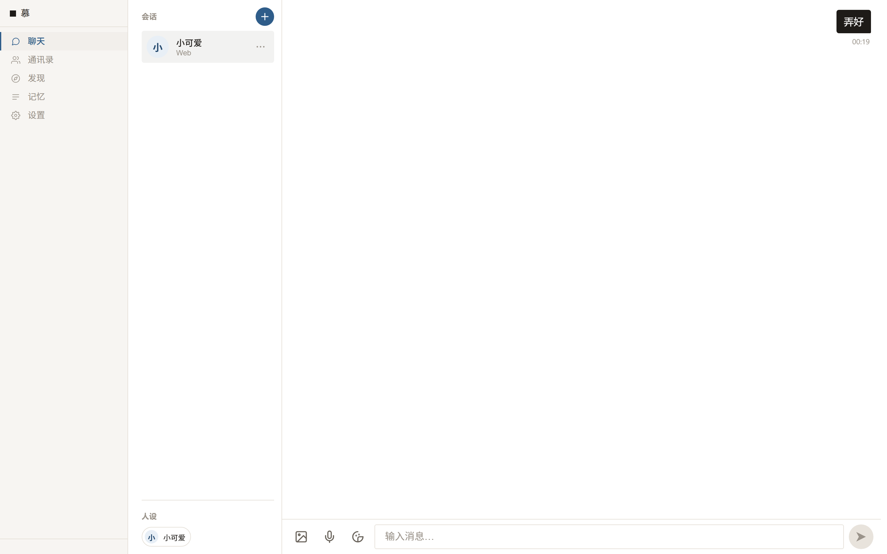
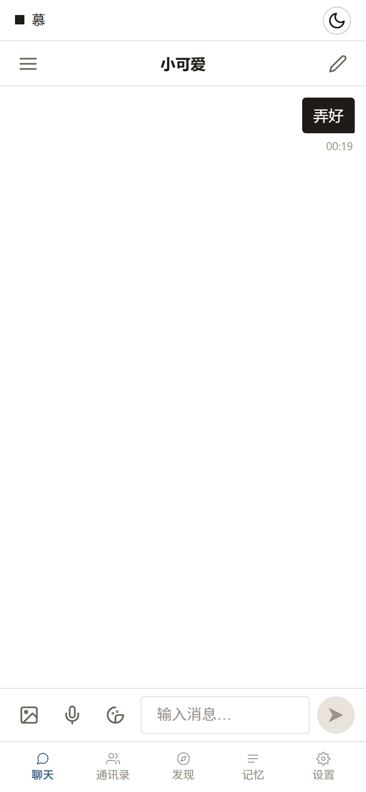
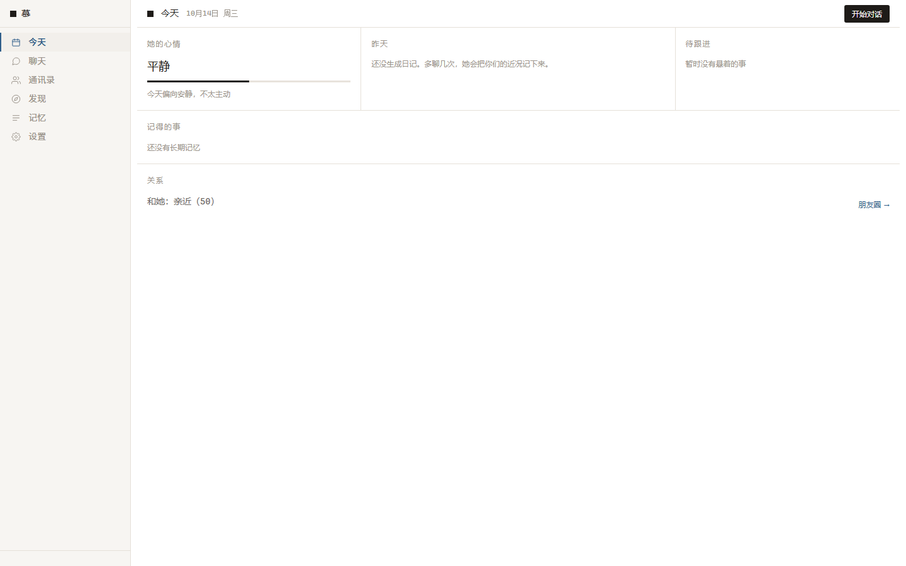
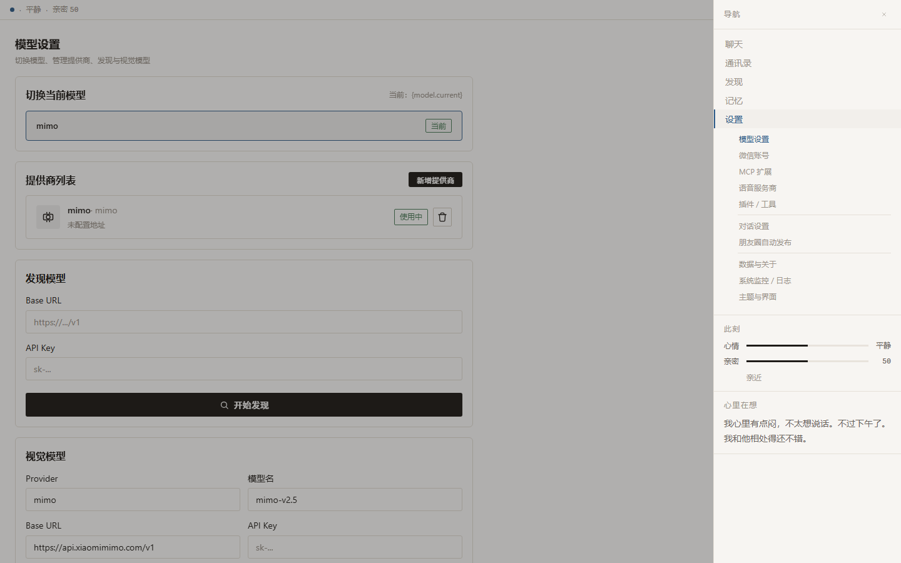

# 慕 (muu)

> 本地优先的 AI 伴侣 —— 多角色 · 长期记忆 · 微信接入 · MCP 扩展

「慕」是一个本地优先的 AI 伴侣。所有数据（聊天记录、记忆、身份、配置）默认存放在你的设备上，不上传云端；模型通过 LiteLLM 统一对接，支持 OpenAI 系、Anthropic、通义、DeepSeek、本地 Ollama 等任意兼容接口。

  

## 🖼️ 界面预览

| 桌面端 | 移动端 |
| --- | --- |
|  |  |

| 「今天」模式（桌面） | 沉浸模式 + 设置抽屉 |
| --- | --- |
|  |  |

> 三套可切换布局：**面板**（经典聊天）/ **今天**（日程与状态一屏总览）/ **沉浸**（全屏对话），自动适配手机与桌面。

---

## ✨ 功能特性

### 🧠 AI 核心
- **多角色人格引擎**：同一个 AI 可配置多套身份（性格、语气、背景故事），随时切换，并有高级配置面板
- **情绪状态机**：对话融入情绪状态，配合人格引擎输出更自然的回应
- **工具调用**：时间/字数/随机数/读文本等内置工具，扩展模型能力边界
- **长短期记忆**：长期记忆管理（`/api/memory`）+ 人生总结（`life_summary`），让 AI 记住你
- **多模型接入**：LiteLLM 统一对接，支持自定义 Provider、模型自动发现、连通性测试、视觉模型

### 💬 使用方式
- **网页端**（WebUI）：手机/桌面浏览器均可访问，自带简洁现代化的界面
- **命令行**（CLI）：本地聊天，`/help` 查看命令
- **微信 Bot**：接入微信，微信消息与本地消息由同一个 AI 处理

### 🔌 能力扩展
- **MCP 扩展**：支持任意 MCP 服务器（System/Web/Weather 等内置，可自定义服务器、命令、参数），开箱即用
- **插件系统**：加载自定义插件
- **语音合成**（TTS）：多语音服务商，网页端可调用音频合成
- **贴纸系统**：内置贴纸包，可导入

### 📱 社交能力
- **朋友圈**：发布、点赞、评论回复，以及**自动发布**（定时/触发）
- **联系人管理**
- **微信账号**：多账号管理、登录二维码

### 🗄️ 数据安全
- **备份 / 恢复**：一键导出完整备份（含恢复前安全检查），支持恢复前预览
- **诊断导出**：生成脱敏诊断报告
- 默认 `CC_PACKAGED` 模式下数据落在用户目录，不污染安装目录

---

## 🚀 快速开始

### 环境要求
- Python 3.11+（建议 3.12）
- 一个兼容 LiteLLM 的模型 API（OpenAI / Anthropic / DeepSeek / 通义 / Ollama 等）

### 安装与启动

```bash
# 1. 克隆仓库
git clone https://github.com/yangmuji14-creator/muu.git
cd muu

# 2. 安装依赖（会自动选择虚拟环境）
python install.py

# 3. 首次运行：配置向导（模型 + 人设）
python main.py setup

# 4. 启动
python main.py            # CLI 聊天（检测到微信配置会自动同时启动微信 Bot）
python main.py web        # 网页端，默认 http://127.0.0.1:8000
```

### CLI 命令一览

| 命令 | 说明 |
| --- | --- |
| `python main.py setup` | 首次配置向导（模型 + 人设） |
| `python main.py` / `run` | 启动聊天（自动检测微信配置） |
| `python main.py web` | 启动网页端 |
| `python main.py wechat` | 配置微信 |
| `python main.py import-skill <路径>` | 导入 ex-skill 人设文件 |
| `python main.py import-chat <路径> --name 名字` | 导入聊天记录 |
| `python main.py restore <备份>` | 恢复备份 |

> 环境变量：`MU_WEB_HOST`（默认 `127.0.0.1`）、`MU_WEB_PORT`（默认 `8000`）可调整网页端监听。

---

## 🌐 网页端（WebUI）

以 `python main.py web` 启动后，浏览器打开 `http://127.0.0.1:8000`。前端为 Svelte 5 + Vite，由后端 aiohttp 托管静态资源。

主要分区：
- **对话**：与各人格身份聊天，支持图片/语音上传
- **记忆**：长期记忆与人生总结管理
- **联系人 / 朋友圈**：社交模块
- **设置**：模型、人设、对话、外观、微信、朋友圈自动发布、语音（TTS）、MCP 扩展、插件、数据备份、监控等

### MCP 扩展
网页端「设置 → MCP 扩展」可管理 MCP 服务器：
- 内置 **System / Web / Weather** 三台能力服务器，开箱即用
- 支持新增 / 编辑 / 测试 / 连接 / 刷新 / 断开 / 查看工具
- 自定义服务器：填写名称、启动命令、参数即可

---

## 🪟 Windows 桌面版（EXE）

项目提供 PyInstaller 打包的 Windows 独立 EXE（无需安装 Python），产物为 onedir 目录：
- 内嵌前端静态资源（`webui/static`）
- 内置 MCP 服务器脚本（`mcp_servers/`）
- 首次启动自动写入默认 MCP 配置（开箱即用）

数据落盘于 `%APPDATA%\Muu\`（config / data / logs），不写进安装目录。打包配置保留在开发侧，不随源码仓库分发。

---

## ⚙️ 技术栈

- **语言**：Python 3.11+
- **模型层**：LiteLLM（统一多模型接入）
- **Web**：aiohttp（后端）+ Svelte 5 / Vite（前端）
- **数据**：SQLite（companion.db）+ 文件存储
- **扩展**：MCP（Model Context Protocol，stdio JSON-RPC）
- **可选**：`sentence-transformers`（向量记忆）、`weixin-ilink`（微信）

### 可选依赖
```bash
pip install -e ".[vector]"    # 向量记忆
pip install -e ".[wechat]"    # 微信
pip install -e ".[dev]"       # 开发/测试
```

---

## 🗂️ 项目结构

```
core/          核心逻辑（brain 认知 / chat 对话 / emotion 情绪 / llm 模型 /
                memory 记忆 / persona 人格 / personality / multimodal 多模态 /
                security 安全 / social 社交 / storage 存储 / tools 工具）
mcp_servers/   内置 MCP 服务器脚本（system / web / weather）
adapters/      适配器（微信等消息通道）
plugins/       插件
webui/         网页端（frontend/ Svelte 前端 + routes/ 按域拆分的后端路由）
main.py        统一入口（CLI / Web / 微信）
```

---

## 📄 许可证

[AGPL-3.0](LICENSE)

自用、修改、部署给朋友用：完全自由，无需任何申请。
唯一起来约束的是二次开发：**基于慕的网络服务必须开源其服务端改动**（防止闭源套壳）。普通个人使用完全无感。

## 💼 商业授权

社区版以 AGPL-3.0 开源。若你的场景无法接受开源义务（闭源集成、企业内部分发、OEM 等），可获取商业授权：
通过 GitHub 联系 [@yangmuji14-creator](https://github.com/yangmuji14-creator)。

## 🤝 参与贡献

欢迎 Issue 与 PR！请先阅读：

- [贡献指南](.github/CONTRIBUTING.md) —— 环境搭建、项目约定、提交自查清单
- [行为守则](.github/CODE_OF_CONDUCT.md)
- [安全策略](.github/SECURITY.md) —— 漏洞请走私密报告渠道

## 📜 更新日志

见 [CHANGELOG.md](CHANGELOG.md)。

---

*「慕」—— 让 AI 成为身边靠得住的伴侣。所有能力本地运行，数据自己掌握。*
